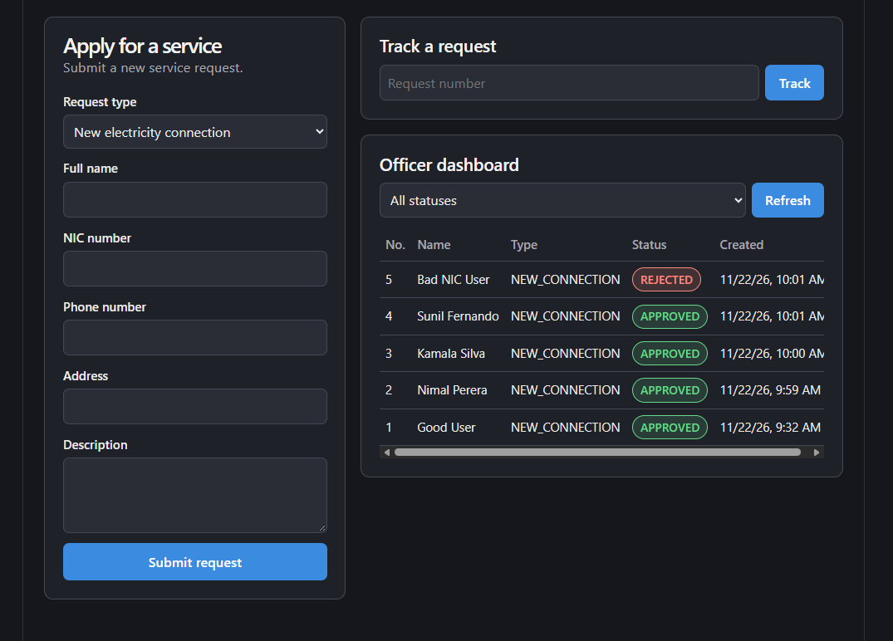
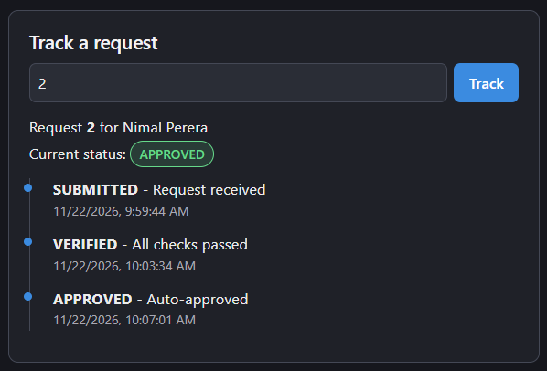
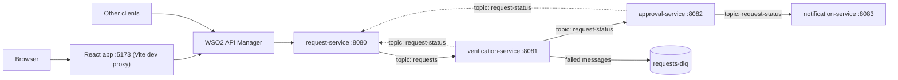

# EDL Service Request System

An event-driven service request system (for example, "apply for a new electricity connection") built with **Spring Boot**, **Apache Kafka**, **WSO2 API Manager** and a **React** frontend.

A citizen submits a request through a web form. The request is verified, approved and notified through a chain of independent services that talk to each other only through Kafka topics. Every call from the browser goes through the WSO2 API gateway.

> Status: backend, Kafka, the WSO2 API gateway and the React frontend (submit form, status tracking, officer dashboard) are working.

## Screenshots



*The submit form (left), the tracking timeline for a rejected request and the officer dashboard with colour-coded statuses (right).*



*Timeline of an approved request: SUBMITTED, VERIFIED, APPROVED, each with the time its service handled it.*

## Architecture



1. The browser (or any client) calls the **WSO2 gateway**. OAuth2 and the rate limit are enforced there.
2. **request-service** saves the request and publishes a `RequestSubmitted` event to the `requests` topic.
3. **verification-service** validates the request and publishes `VERIFIED` or `REJECTED` to `request-status`.
4. **approval-service** reacts only to `VERIFIED` and publishes `APPROVED` (auto-approved for now).
5. **notification-service** logs a notification for `APPROVED` or `REJECTED`.
6. **request-service** also reads `request-status` to update the saved request and record a status history, which the frontend shows as a timeline.

Statuses: `SUBMITTED`, `UNDER_VERIFICATION`, `VERIFIED`, `APPROVED`, `REJECTED`.

## Services

| Service | Port | Consumer group | Role |
|---|---|---|---|
| request-service | 8080 | request-group | REST API, saves requests (H2), publishes events, records history |
| verification-service | 8081 | verification-group | Validates NIC, phone and address; retry + dead-letter topic |
| approval-service | 8082 | approval-group | Approves verified requests |
| notification-service | 8083 | notification-group | Logs notifications |
| frontend | 5173 | - | React app (Vite dev server with a proxy to WSO2) |

Kafka topics (3 partitions each): `requests`, `request-status`, `notifications` (not used yet), `requests-dlq`.

Message keys are the request ID, so all events for one request go to the same partition and stay in order.

## Frontend

A single page with three cards:

- **Apply for a service**: a form with loading, error and success states. It shows clear messages for an expired token (401) and for rate limiting (429). There are no NIC or phone checks in the browser on purpose: the check belongs to verification-service, so a bad NIC visibly ends up as `REJECTED`.
- **Track a request**: enter a request number to see its current status and a timeline built from `/requests/{id}/history`. A missing request shows "No request found".
- **Officer dashboard**: a table of all requests, newest first, with a status filter, a refresh button and colour-coded status badges. It is view-only.

The layout has two columns on wide screens and one column on narrow screens.

The browser never holds the WSO2 token. The Vite dev server proxies every call that starts with `/api` to the WSO2 gateway, rewrites `/api/...` to `/requestapi/1.0.0/...`, and adds the `Authorization: Bearer` header on the server side. This also avoids CORS problems, because the browser only talks to one address.

## Tech stack

Java 17, Spring Boot 4.2.0, Maven, Apache Kafka 3.9.0 (KRaft mode), Kafka UI, WSO2 API Manager 4.6.0, H2 (in-memory), Docker Compose, React with Vite 8 and ESLint, PowerShell or Postman for testing.

## Run it

Requirements: Docker Desktop, Java 17, Node.js 22, about 16 GB of RAM (see Known limitations).

### 1. Start Kafka, Kafka UI and WSO2

```powershell
cd infra
docker compose up -d
```

- Kafka UI: http://localhost:8090
- WSO2 Publisher: https://localhost:9443/publisher (accept the self-signed certificate warning)
- WSO2 Developer Portal: https://localhost:9443/devportal
- WSO2 default login for local development: `admin` / `admin`

Create the four topics once, with 3 partitions each (or create them in Kafka UI). For example:

```powershell
docker exec kafka /opt/kafka/bin/kafka-topics.sh --bootstrap-server localhost:9092 --create --topic requests --partitions 3 --replication-factor 1
```

Repeat with `request-status`, `notifications` and `requests-dlq`.

### 2. Start the services

Open one terminal per service and run:

```powershell
cd request-service
.\mvnw.cmd spring-boot:run
```

Repeat for `verification-service`, `approval-service` and `notification-service`. On a low-memory laptop, add `"-Dspring-boot.run.jvmArguments=-Xmx256m"` to limit the Java heap.

### 3. Set up the API in WSO2

1. In the **Publisher**, create a REST API from scratch: name `RequestAPI`, context `/requestapi`, version `1.0.0`, endpoint `http://host.docker.internal:8080` (the WSO2 container reaches the host through this name).
2. **Deploy** it to the Default gateway, then **Publish** it.
3. In the **Developer Portal**, create an application, subscribe it to RequestAPI, open **Production Keys**, generate keys and generate an access token.

The WSO2 configuration is stored inside the container, so it has to be recreated if the container is removed.

### 4. Start the frontend

```powershell
cd frontend
npm install
```

Create a file named `.env.local` in the `frontend` folder that contains one line with your access token:

```
WSO2_TOKEN=PASTE_ACCESS_TOKEN_HERE
```

Then start the dev server and open http://localhost:5173:

```powershell
npm run dev
```

`.env.local` is ignored by Git (the `*.local` rule), so the token is never committed.

**When the token expires** the form and dashboard show a "Not authorised (401)" message. Generate a new token in the Developer Portal (Applications, your application, Production Keys, Generate Access Token), replace the value in `.env.local`, and restart `npm run dev`. The dev server reads the file only at startup.

### 5. Test the API from the terminal

Calls go to the gateway on port 8280, not straight to request-service.

```powershell
$token = "PASTE_ACCESS_TOKEN_HERE"

# Create a request
Invoke-RestMethod -Uri http://localhost:8280/requestapi/1.0.0/requests -Method Post -ContentType "application/json" -Headers @{ Authorization = "Bearer $token" } -Body '{"type":"NEW_CONNECTION","citizenName":"Good User","nic":"199012345678","phone":"0771234567","address":"Jaffna Town","description":"test"}'

# Read it back (status becomes APPROVED after the chain runs)
Invoke-RestMethod -Uri http://localhost:8280/requestapi/1.0.0/requests/1 -Method Get -Headers @{ Authorization = "Bearer $token" }

# Status timeline
Invoke-RestMethod -Uri http://localhost:8280/requestapi/1.0.0/requests/1/history -Method Get -Headers @{ Authorization = "Bearer $token" }
```

A call without a token returns `401`. Too many calls in a short time return `429`.

A request with an invalid NIC (for example `"nic":"12345"`) ends as `REJECTED` with the reason "Invalid NIC".

## Why Kafka?

- **Loose coupling.** The services never call each other. Each one reads a topic and writes a topic, so one can be stopped, changed or replaced without touching the others.
- **Messages wait.** When a service is down, its events stay in Kafka and are processed when it starts again. During testing the verification and approval services were started one at a time, and every waiting request moved forward in order.
- **Ordering per request.** The request ID is the message key, so all events for one request stay in order.
- **Failure handling.** A bad message is retried three times and then sent to a dead-letter topic instead of blocking everything behind it.

## Why WSO2 API Manager?

- **One place for security.** OAuth2 tokens are checked at the gateway, so none of the four services needs its own login code.
- **Rate limiting.** Throttling per application is a setting, not code. A client that sends too many calls gets `429`.
- **Versioning and publishing.** APIs are published, subscribed to and versioned (`1.0.0` and `2.0.0` exist) without changing the backend.
- **A single entry point.** The frontend talks to one address, and the backend services can move or change behind it.

## What has been tested

- Full chain: request, verification, approval, notification, and the status update in request-service.
- Good and bad requests (`APPROVED` and `REJECTED`) with the status history.
- Retry (3 times) and dead-letter topic for a bad message in verification-service.
- Loop protection: approval-service ignores its own `APPROVED` events.
- WSO2: OAuth2 (`401` without a token, `200` with one), throttling (`429`), and two published versions (`1.0.0` and `2.0.0`).
- Frontend through the Vite proxy and WSO2: submitting good and bad requests, tracking a request with its timeline, a missing request number, and the dashboard showing a mix of `APPROVED` and `REJECTED` requests.

## Known limitations

- H2 is in memory, so saved requests are lost when request-service restarts (Kafka keeps the old events).
- Approval is automatic, so the officer dashboard is view-only. `UNDER_VERIFICATION` exists but nothing sets it yet.
- Only verification-service has the retry and dead-letter setup.
- Notifications are log lines only, with no real email or SMS.
- WSO2 version `2.0.0` currently behaves the same as `1.0.0`.
- WSO2 analytics is not enabled.
- The frontend uses a Vite dev proxy with a token stored in a local file. This is for development only. A production setup would use a small backend service or a proper login flow to handle tokens.
- The access token expires and has to be refreshed by hand. The pages do not refresh themselves; use the Track and Refresh buttons.
- The services run from the terminal and are not yet in Docker Compose. With WSO2, Kafka and four Java services, a 16 GB laptop is tight, so the services were run one at a time in testing.
