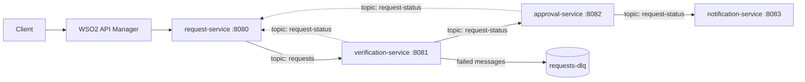

# EDL Service Request System

An event-driven service request system (for example, "apply for a new electricity connection") built with **Spring Boot**, **Apache Kafka** and **WSO2 API Manager**.

A citizen submits a request through an API. The request is verified, approved and notified through a chain of independent services that talk to each other only through Kafka topics.

> Status: backend, Kafka and the WSO2 API gateway are working. The React frontend is planned and not built yet.

## Architecture



1. The client calls the **WSO2 gateway** (OAuth2 token and rate limit are enforced there).
2. **request-service** saves the request and publishes a `RequestSubmitted` event to the `requests` topic.
3. **verification-service** validates the request and publishes `VERIFIED` or `REJECTED` to `request-status`.
4. **approval-service** reacts only to `VERIFIED` and publishes `APPROVED` (auto-approved for now).
5. **notification-service** logs a notification for `APPROVED` or `REJECTED`.
6. **request-service** also reads `request-status` to update the saved request and record a status history.

Statuses: `SUBMITTED`, `UNDER_VERIFICATION`, `VERIFIED`, `APPROVED`, `REJECTED`.

## Services

| Service | Port | Consumer group | Role |
|---|---|---|---|
| request-service | 8080 | request-group | REST API, saves requests (H2), publishes events, records history |
| verification-service | 8081 | verification-group | Validates NIC, phone and address; retry + dead-letter topic |
| approval-service | 8082 | approval-group | Approves verified requests |
| notification-service | 8083 | notification-group | Logs notifications |

Kafka topics (3 partitions each): `requests`, `request-status`, `notifications` (not used yet), `requests-dlq`.

Message keys are the request ID, so all events for one request go to the same partition and stay in order.

## Tech stack

Java 17, Spring Boot 4.2.0, Maven, Apache Kafka 3.9.0 (KRaft mode), Kafka UI, WSO2 API Manager 4.6.0, H2 (in-memory), Docker Compose, Postman or PowerShell for testing.

## Run it

Requirements: Docker Desktop, Java 17, about 16 GB of RAM (see Known limitations).

### 1. Start Kafka, Kafka UI and WSO2

```powershell
cd infra
docker compose up -d
```

- Kafka UI: http://localhost:8090
- WSO2 Publisher: https://localhost:9443/publisher (accept the self-signed certificate warning)
- WSO2 Developer Portal: https://localhost:9443/devportal
- WSO2 default login for local development: `admin` / `admin`

Create the four topics once, with 3 partitions each (or create them in Kafka UI).

### 2. Start the services

Open one terminal per service and run:

```powershell
cd request-service
.\mvnw.cmd spring-boot:run
```

Repeat for `verification-service`, `approval-service` and `notification-service`. On a low-memory laptop, add `"-Dspring-boot.run.jvmArguments=-Xmx256m"` to limit the Java heap.

### 3. Set up the API in WSO2

1. In the **Publisher**, create a REST API from scratch: name `RequestAPI`, context `/requestapi`, version `1.0.0`, endpoint `http://host.docker.internal:8080` (the WSO2 container reaches the host through this name).
2. **Deploy** it to the Default gateway, then **Publish** it.
3. In the **Developer Portal**, create an application, subscribe it to RequestAPI, open **Production Keys**, generate keys and generate an access token.

The WSO2 configuration is stored inside the container, so it has to be recreated if the container is removed.

### 4. Test it

Calls go to the gateway on port 8280, not straight to request-service.

```powershell
$token = "PASTE_ACCESS_TOKEN_HERE"

# Create a request
Invoke-RestMethod -Uri http://localhost:8280/requestapi/1.0.0/requests -Method Post -ContentType "application/json" -Headers @{ Authorization = "Bearer $token" } -Body '{"type":"NEW_CONNECTION","citizenName":"Good User","nic":"199012345678","phone":"0771234567","address":"Jaffna Town","description":"test"}'

# Read it back (status becomes APPROVED after the chain runs)
Invoke-RestMethod -Uri http://localhost:8280/requestapi/1.0.0/requests/1 -Method Get -Headers @{ Authorization = "Bearer $token" }

# Status timeline
Invoke-RestMethod -Uri http://localhost:8280/requestapi/1.0.0/requests/1/history -Method Get -Headers @{ Authorization = "Bearer $token" }
```

A call without a token returns `401`. Too many calls in a short time return `429`.

A request with an invalid NIC (for example `"nic":"12345"`) ends as `REJECTED` with the reason "Invalid NIC".

## What has been tested

- Full chain: request, verification, approval, notification, and the status update in request-service.
- Good and bad requests (`APPROVED` and `REJECTED`) with the status history.
- Retry (3 times) and dead-letter topic for a bad message in verification-service.
- Loop protection: approval-service ignores its own `APPROVED` events.
- WSO2: OAuth2 (`401` without a token, `200` with one), throttling (`429`), and two published versions (`1.0.0` and `2.0.0`).

## Known limitations

- H2 is in memory, so saved requests are lost when request-service restarts (Kafka keeps the old events).
- Approval is automatic. `UNDER_VERIFICATION` exists but nothing sets it yet.
- Only verification-service has the retry and dead-letter setup.
- Notifications are log lines only, with no real email or SMS.
- WSO2 version `2.0.0` currently behaves the same as `1.0.0`.
- WSO2 analytics is not enabled.
- The services run from the terminal and are not yet in Docker Compose. With WSO2, Kafka and four Java services, a 16 GB laptop is tight, so the services were run one at a time in testing.
- The React frontend (submit form, status timeline, officer dashboard) is planned.
